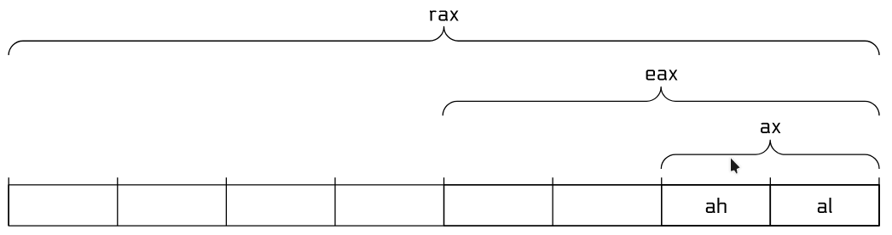
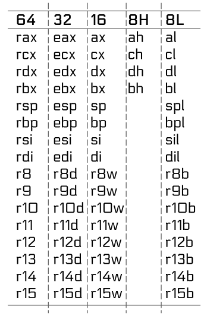

# registers

rax -> return value, accumulator
rcx -> counter, loop control
rdx -> data, I/O
rbx -> base, pointer
rsp -> stack pointer
rbp -> base pointer, frame pointer
rsi -> source index, pointer
rdi -> destination index, pointer
r8  -> general purpose register
r9  -> general purpose register
r10 -> general purpose register
r11 -> general purpose register
r12 -> general purpose register
r13 -> general purpose register
r14 -> general purpose register
r15 -> general purpose register

## partial registers

## syscall arguments

- rdi -> 1st argument (arg0)
- rsi -> 2nd argument (arg1)
- rdx -> 3rd argument (arg2)
- r10 -> 4th argument (arg3)
- r8  -> 5th argument (arg4)
- r9  -> 6th argument (arg5)

## syscalls

(s. syscall.sh)

### syscall numbers

- 0 -> read
- 1 -> write
- 2 -> open
- 3 -> close
- 60 -> exit (exit code in rdi)
